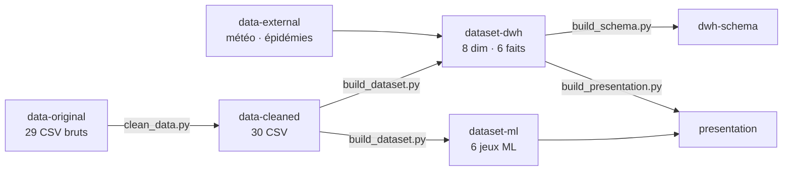

# Health Retailers — plateforme décisionnelle BI & Machine Learning pour un drugstore

Projet Data Engineering · Classe 3IA · ESPRIT.

À partir de l'export brut du logiciel de gestion d'un drugstore (29 fichiers CSV, 30/09/2024 → 30/04/2025),
le projet construit un **Data Warehouse**, des **tableaux de bord BI** et **quatre cas de Machine Learning**
(prévision de la demande, anomalies de ventes, anomalies de caisse, segmentation client), selon le
[cahier de spécification](docs/cahier-de-spec.pdf).

## Organisation : une branche par livrable

Chaque branche est indépendante et contient **un seul type de contenu** avec son propre README.

| Branche | Contenu | Produit par |
|---|---|---|
| [`main`](../../tree/main) | Ce README, les scripts du pipeline, les documents de cadrage (`docs/`) | — |
| [`data-original`](../../tree/data-original) | Les 29 CSV bruts, à l'identique de l'export reçu | Export du logiciel |
| [`data-external`](../../tree/data-external) | Données externes : météo (Open-Meteo) et épidémies (réseau Sentinelles) | `build_dataset.py` (téléchargement) |
| [`data-cleaned`](../../tree/data-cleaned) | 30 CSV nettoyés + rapport de nettoyage détaillé | `clean_data.py` |
| [`dataset-dwh`](../../tree/dataset-dwh) | Data Warehouse : 8 dimensions, 6 tables de faits, contrôles qualité | `build_dataset.py` |
| [`dataset-ml`](../../tree/dataset-ml) | 6 jeux de données Machine Learning (variables `X_`, cibles `Y_`) | `build_dataset.py` |
| [`dwh-schema`](../../tree/dwh-schema) | Schéma du DWH : diagramme, dictionnaire PDF, script SQL (PK / FK) | `build_schema.py` |
| [`presentation`](../../tree/presentation) | Support de la première validation (PowerPoint) | `build_presentation.py` |

## Pipeline



## Contenu de `main`

| Élément | Rôle |
|---|---|
| `clean_data.py` | Nettoie les CSV bruts (`fichiers/`) → `cleaned/` + `CLEANING_REPORT.md` |
| `build_dataset.py` | Construit le DWH et les jeux ML → `dataset/` ; télécharge les données externes dans `externe/` |
| `build_schema.py` | Génère le schéma du DWH → `dataset/schema/` |
| `build_presentation.py` | Génère la présentation → `presentation/` (nécessite `pip install python-pptx`) |
| `docs/cahier-de-spec.pdf` | Cahier de spécification décisionnelle (version de référence) |
| `docs/PrésentationDE.pdf` | Présentation du projet par l'école |
| `docs/Dataset_Guide_Health_Retailers.pdf` | Guide des 29 fichiers sources et de leurs liens |
| `docs/archives/` | Version précédente du cahier de spécification |

Les scripts n'utilisent que la bibliothèque standard Python (sauf `build_presentation.py`).

## Récupérer une seule branche

```bash
git clone --branch dataset-dwh --single-branch https://github.com/Youssef-ben-ali/DataWarehouseProject_3AI4.git dwh
```

## Reproduire tout le pipeline

Les scripts attendent les dossiers `fichiers/`, `externe/`, `cleaned/`, `dataset/` à côté d'eux.
On les obtient en montant les branches comme dossiers avec `git worktree` :

```bash
git clone https://github.com/Youssef-ben-ali/DataWarehouseProject_3AI4.git health-retailers && cd health-retailers
git worktree add fichiers data-original
git worktree add externe  data-external
git worktree add cleaned  data-cleaned
mkdir dataset
git worktree add dataset/dwh    dataset-dwh
git worktree add dataset/ml     dataset-ml
git worktree add dataset/schema dwh-schema
git worktree add presentation   presentation

python clean_data.py          # met à jour cleaned/
python build_dataset.py       # met à jour dataset/dwh, dataset/ml (+ README et contrôles à la racine de dataset/)
python build_schema.py        # met à jour dataset/schema
python build_presentation.py  # met à jour presentation/
```

Chaque dossier étant une branche, `git status` dans le dossier montre ce qui a changé.

## Chiffres clés

| | |
|---|---|
| Période | 30/09/2024 → 30/04/2025 (7 mois) |
| Sources | 29 CSV · 370 256 enregistrements |
| CA HT (ventes validées, sans double comptage) | 1 021 293 |
| Documents de vente | 11 571 · panier moyen 88,26 HT |
| Data Warehouse | 8 dimensions · 6 tables de faits · 100 % des clés étrangères vérifiées |

## Données externes

- **Météo** : [Open-Meteo](https://open-meteo.com/) (API archive), Paris, journalier — licence CC BY 4.0.
- **Épidémies** : [réseau Sentinelles](https://www.sentiweb.fr/) (Inserm, Sorbonne Université), incidences hebdomadaires France.
- **Calendrier** : jours fériés calculés, vacances scolaires officielles 2024-2025.

## Équipe

[Nom du groupe] — [Membre 1], [Membre 2], [Membre 3], [Membre 4]
