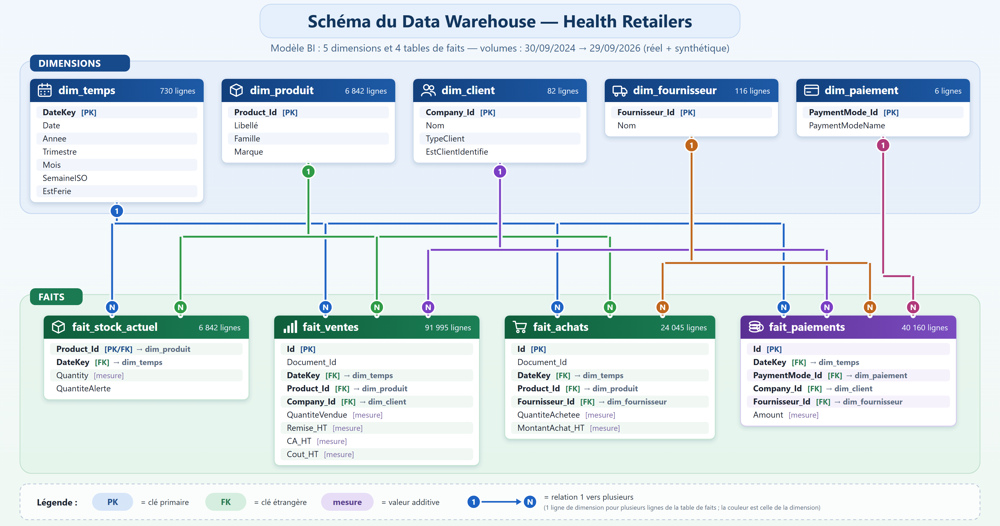

# Schéma du Data Warehouse – version B

Produit par `build_schema.py` (branche `main`), qui vérifie que la description correspond exactement aux colonnes des tables de [`dataset-dwh`](../../tree/dataset-dwh).

| Fichier | Contenu |
|---|---|
| `schema_dwh.pdf` / `schema_dwh.html` | Descriptif détaillé : modèle, tables, relations, dictionnaire de chaque colonne, mesures Power BI, différences avec la version A, règles de chargement |
| `schema_dwh_diagramme.png` / `.svg` | Diagramme seul |
| `schema_dwh.sql` | `CREATE TABLE` PostgreSQL avec clés primaires et étrangères + commandes de chargement des CSV |

Modèle : 4 tables de faits (ventes, achats, stock actuel, paiements) partagent 5 dimensions (temps, produit, client, fournisseur, paiement). Période : 2024-09-30 → 2026-09-29 (réel jusqu'au 2025-04-30, synthétique ensuite).

Retour à la vue d'ensemble : branche [`main`](../../tree/main).
