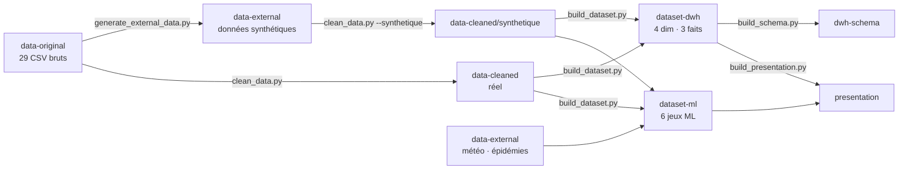

# Health Retailers — plateforme décisionnelle BI & Machine Learning pour un drugstore

Projet Data Engineering · Classe 3IA · ESPRIT.

À partir de l'export brut du logiciel de gestion d'un drugstore (29 fichiers CSV, 30/09/2024 → 30/04/2025), prolongé
par des données synthétiques jusqu'au 29/09/2026 (2 ans au total), le projet construit un **Data Warehouse**, des
**tableaux de bord BI** et **quatre cas de Machine Learning** (prévision de la demande, anomalies de ventes, anomalies
de caisse, segmentation client), selon le [cahier de spécification](docs/cahier-de-spec.pdf) — **version B** :
modèle simplifié à **4 dimensions et 3 tables de faits**.

## Organisation : une branche par livrable

Chaque branche est indépendante et contient **un seul type de contenu** avec son propre README.

| Branche | Contenu | Produit par |
|---|---|---|
| [`main`](../../tree/main) | Ce README, les scripts du pipeline, les documents de cadrage (`docs/`) | — |
| [`data-original`](../../tree/data-original) | Les 29 CSV bruts, à l'identique de l'export reçu | Export du logiciel |
| [`data-external`](../../tree/data-external) | Données externes : météo (Open-Meteo), épidémies (Réseau Sentinelles), données synthétiques (prolongation à 2 ans) | `build_dataset.py` (téléchargement), `generate_external_data.py` |
| [`data-cleaned`](../../tree/data-cleaned) | Fichiers nettoyés + rapport de nettoyage ; `synthetique/` pour la période générée | `clean_data.py` |
| [`script-cleaning`](../../tree/script-cleaning) | Le nettoyage découpé en un script par fichier brut (`script_cleaning_<fichier>.py`), mêmes résultats que `clean_data.py` | — |
| [`dataset-dwh`](../../tree/dataset-dwh) | Data Warehouse : 4 dimensions, 3 tables de faits, dictionnaire, contrôles qualité | `build_dataset.py` |
| [`dataset-ml`](../../tree/dataset-ml) | 6 jeux de données Machine Learning (variables `X_`, cibles `Y_`) | `build_dataset.py` |
| [`dwh-schema`](../../tree/dwh-schema) | Schéma du DWH : diagramme, descriptif PDF, script SQL (PK / FK) | `build_schema.py` |
| [`presentation`](../../tree/presentation) | Support de la première validation (PowerPoint), modèle révisé | `build_presentation.py` |

## Pipeline



## Contenu de `main`

| Élément | Rôle |
|---|---|
| `generate_external_data.py` | Génère la suite synthétique de l'export (01/05/2025 → 29/09/2026), mêmes fichiers et formats → `externe/donnees_synthetiques/` |
| `clean_data.py` | Nettoie les CSV bruts → `cleaned/` ; avec `--synthetique`, les données générées → `cleaned/synthetique/` |
| `build_dataset.py` | Construit le DWH (version B) et les jeux ML → `dataset/` ; télécharge météo et épidémies dans `externe/` |
| `build_schema.py` | Génère le schéma du DWH (diagramme, descriptif PDF, SQL) → `dataset/schema/` |
| `build_presentation.py` | Génère la présentation → `presentation/` (nécessite `pip install python-pptx`) |
| `docs/cahier-de-spec.pdf` | Cahier de spécification décisionnelle — version B (référence) |
| `docs/cahier-de-spec.html` | Source modifiable du cahier (à réimprimer en PDF depuis Chrome) |
| `docs/PrésentationDE.pdf` | Présentation du projet par l'école |
| `docs/Dataset_Guide_Health_Retailers.pdf` | Guide des 29 fichiers sources et de leurs liens |
| `docs/archives/` | Versions précédentes du cahier de spécification (dont la version A) |

Les scripts n'utilisent que la bibliothèque standard Python (sauf `build_presentation.py`) ; `build_schema.py` utilise
Chrome ou Edge, s'ils sont installés, pour produire le PNG et le PDF.

## Récupérer une seule branche

```bash
git clone --branch dataset-dwh --single-branch https://github.com/Youssef-ben-ali/DataWarehouseProject_3AI4.git dwh
```

## Reproduire tout le pipeline

Les scripts attendent les dossiers `fichiers/`, `externe/`, `cleaned/`, `dataset/` à côté d'eux.
On les obtient en montant les branches comme dossiers avec `git worktree` :

```bash
git clone https://github.com/Youssef-ben-ali/DataWarehouseProject_3AI4.git health-retailers && cd health-retailers
git worktree add fichiers data-original
git worktree add externe  data-external
git worktree add cleaned  data-cleaned
git worktree add scripts_cleaning script-cleaning   # optionnel : un script de nettoyage par fichier
mkdir dataset
git worktree add dataset/dwh    dataset-dwh
git worktree add dataset/ml     dataset-ml
git worktree add dataset/schema dwh-schema
git worktree add presentation   presentation

python generate_external_data.py      # met à jour externe/donnees_synthetiques (graine fixe : résultat identique)
python clean_data.py                  # met à jour cleaned/
python clean_data.py --synthetique    # met à jour cleaned/synthetique/
python build_dataset.py               # met à jour dataset/dwh et dataset/ml
python build_schema.py                # met à jour dataset/schema
python build_presentation.py          # met à jour presentation/
```

Chaque dossier étant une branche, `git status` dans le dossier montre ce qui a changé.

## Chiffres clés

| | |
|---|---|
| Période | 30/09/2024 → 29/09/2026 : réel jusqu'au 30/04/2025 (7 mois), synthétique ensuite (délimitation par la date) |
| Sources | 29 CSV · 370 256 enregistrements réels |
| CA HT réel (ventes validées, sans double comptage) | 1 021 293 · 11 571 ventes · panier moyen 88,26 HT |
| CA HT sur 2 ans (réel + synthétique) | 3 833 428 · 42 540 ventes · panier moyen 90,11 HT |
| Data Warehouse | 4 dimensions · 3 tables de faits · 100 % des clés étrangères vérifiées |

## Données externes

- **Météo** : [Open-Meteo](https://open-meteo.com/) (API archive), Paris, journalier — licence CC BY 4.0 — jeu ML de prévision uniquement.
- **Épidémies** : [Réseau Sentinelles](https://www.sentiweb.fr/) (Inserm, Sorbonne Université), incidences hebdomadaires France — jeu ML de prévision uniquement.
- **Données synthétiques** : prolongation de l'export à 2 ans, hypothèses documentées dans `data-external`.
- Le calendrier français (jours fériés) est calculé ; les vacances scolaires ne sont pas retenues.

## Équipe

[Nom du groupe] — [Membre 1], [Membre 2], [Membre 3], [Membre 4]
